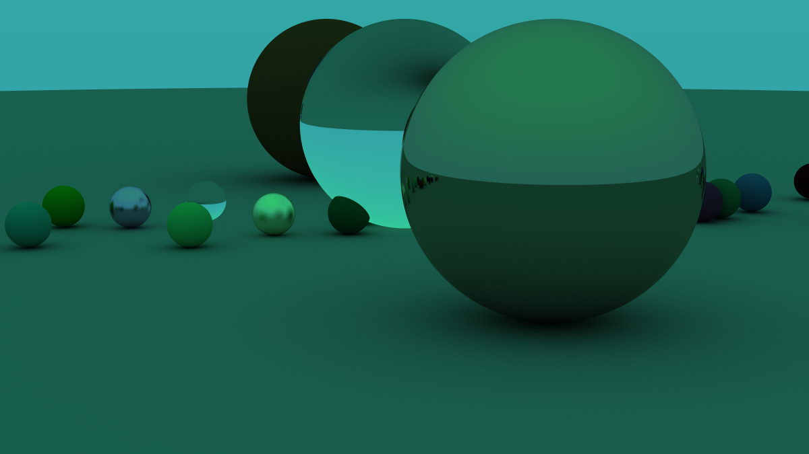

# Ray tracer in C++

A ray tracer written from scratch in C++17, following Peter Shirley's
[*Ray Tracing in One Weekend*](https://raytracing.github.io/books/RayTracingInOneWeekend.html).



*1200×675 px, 500 samples per pixel, up to 50 bounces per ray.*

## Features
- Ray–sphere intersection behind a `hittable` interface, so new shapes can be added
- Antialiasing by averaging random samples within each pixel
- Three materials: diffuse (Lambertian), metal with adjustable fuzz, and glass (refraction with Schlick reflectance)
- Positionable camera with adjustable field of view and defocus blur (depth of field)

## Build and run
```bash
cmake -S . -B build -DCMAKE_BUILD_TYPE=Release
cmake --build build
./build/raytracer > image.ppm
```
`Release` matters: without it CMake builds with no optimisation and the render takes many times longer.

The output is a plain-text PPM image. To convert it to PNG:
```bash
python3 -c "from PIL import Image; Image.open('image.ppm').save('docs/render.png')"
```

## Code layout
| File | Purpose |
|---|---|
| `vec3.h` | 3D vector maths, also used for points and colours |
| `ray.h` | A ray: origin + t · direction |
| `hittable.h`, `hittable_list.h` | Interface for objects a ray can hit, and a list of them |
| `sphere.h` | Ray–sphere intersection |
| `material.h` | Lambertian, metal and dielectric scattering |
| `camera.h` | Generates rays for each pixel and renders the image |
| `interval.h`, `rtweekend.h`, `color.h` | Helpers: ranges, constants, random numbers, colour output |

## What I learned
<!-- Optional: replace this comment with 2–3 sentences in your own words
     (what was hardest, what you'd add next). If you leave it, nothing shows on GitHub. -->
